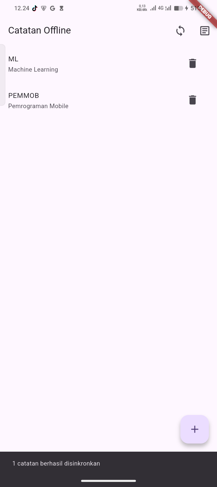
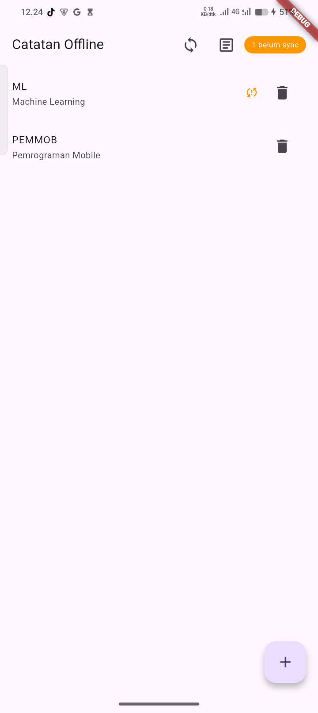
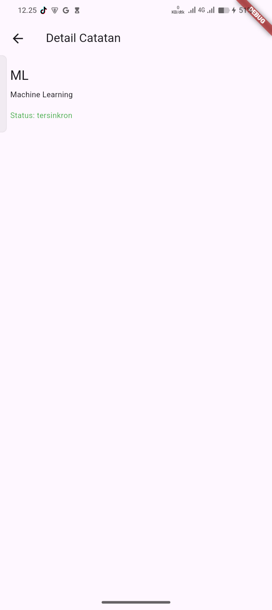
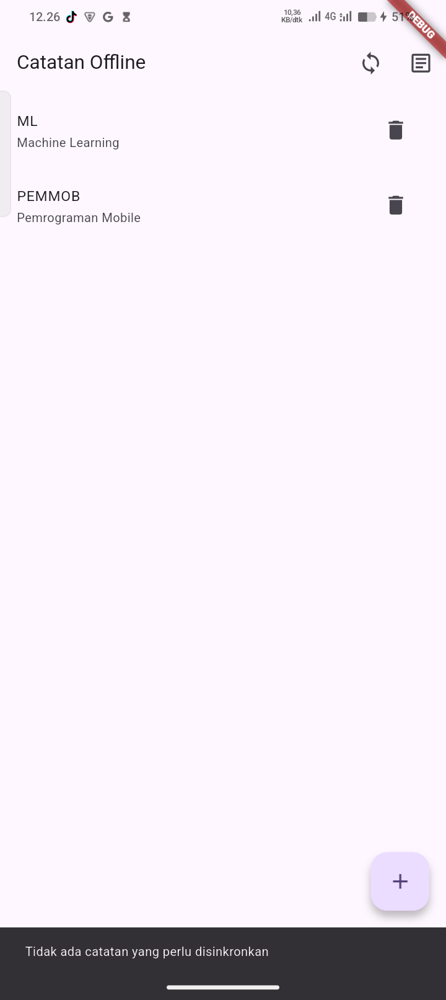
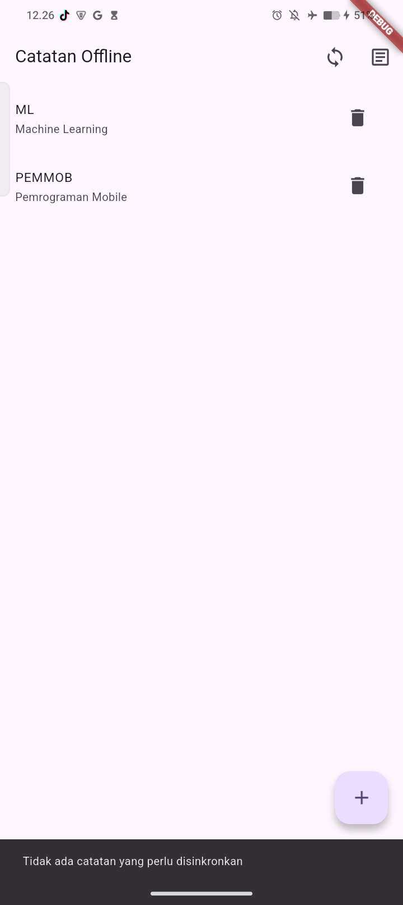
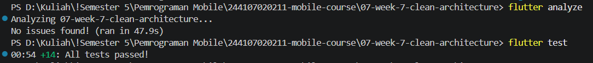

# Week 7 - Clean Architecture

Project ini lanjutan dari Minggu 5 (`week5_offline_notes`). Saya salin ke folder
ini lalu merombak strukturnya menjadi Clean Architecture dengan pola
feature-first. Tampilan dan cara kerja aplikasinya sengaja saya biarkan sama
seperti sebelumnya, yang berubah hanya cara kodenya disusun.

Aplikasinya punya dua fitur. Notes adalah catatan offline yang disimpan di
SQLite, lengkap dengan badge jumlah catatan yang belum sync dan halaman detail.
Posts membaca data dari JSONPlaceholder dengan cache, plus tombol Force Offline
untuk mensimulasikan tidak ada koneksi.

## Teknologi

Flutter 3.47.2 (Dart 3.13.2), Riverpod 3.4.3 untuk state dan dependency
injection, GoRouter 18.0.1 untuk routing, sqflite 2.4.4 untuk database lokal,
dan Dio 5.11.1 untuk mengambil data posts.

Paket `shared_preferences` dan `hive` masih ada di `pubspec.yaml`, tapi kode
yang memakainya sudah saya hapus karena halamannya tidak pernah punya rute.

## Arah dependensi

```
presentation  ->  domain  <-  data
```

Presentation dan data sama-sama bergantung ke domain, bukan sebaliknya. Domain
tidak mengimpor Flutter, Dio, ataupun sqflite, jadi use case bisa dites tanpa
database dan tanpa internet. Widget juga tidak membuat repository sendiri.
Semua pemasangannya ada di file `presentation/providers/*_providers.dart`.

Untuk error, repository tidak melempar exception ke UI. Hasilnya dikembalikan
sebagai record `({List<Note> notes, Failure? failure})`, dan UI hanya
menampilkan `failure.message`.

## Cara menjalankan

```bash
flutter pub get
flutter run
flutter analyze
flutter test
```

## Hasil verifikasi

Semua pemeriksaan di bawah dijalankan pada 12 Oktober 2026.

Pertama, memastikan presentation tidak menyentuh data mentah. Hasilnya harus
kosong.

```
rg -n "Dio\(|openDatabase|getDatabasesPath|FlutterSecureStorage|SharedPreferences\.getInstance|jsonDecode" lib/features --glob "**/presentation/**"
```

Kedua, memastikan domain dan core bersih dari package framework. Hasilnya juga
harus kosong.

```
rg -n "import 'package:flutter|import 'package:dio|import 'package:sqflite|import 'package:firebase" lib/features lib/core --glob "**/domain/**" --glob "lib/core/**"
```

Kedua perintah di atas tidak menemukan apa pun (exit code 1).

Ketiga, `lib/pages` dan `lib/providers` yang lama sudah tidak ada, jadi
repository tidak lagi dibuat di halaman. Sekarang hanya dibuat di provider tiap
fitur.

Terakhir, `flutter analyze` menyatakan `No issues found!` dan `flutter test`
lulus semua (14 test). Rinciannya: `GetNotes` 2 test, `SyncNotes` 3 test,
`GetPosts` 3 test, `NoteModel` 3 test, dan `core/format` 3 test. Semuanya
memakai repository palsu yang meng-`implements` interface, jadi tidak butuh
database atau jaringan sungguhan.

## Screenshot

Pengujian manual saya lakukan di HP fisik (V2310, Android 15) lewat
`flutter run`. Dua gambar pertama membandingkan kondisi yang sama sebelum dan
sesudah refactor.

| Kondisi | Minggu 5 | Minggu 7 |
|---|---|---|
| Ada catatan yang belum sync |  |  |
| Setelah tombol sync ditekan |  |  |

Tampilan lain di versi Minggu 7:

| Daftar catatan | Detail catatan | Posts (online) | Posts (Force Offline) |
|---|---|---|---|
|  |  |  |  |

Hasil `flutter analyze` dan `flutter test` di terminal:



Hasil pemeriksaan grep (tidak ada output berarti tidak ada temuan):


## Hal yang belum rapi

Fitur posts masih bergantung pada fitur notes. `PostRepositoryImpl` mengimpor
`features/notes/data/local/db.dart` karena tabel `notes` dan `cached_posts`
berada di satu file database. Jadi kalau fitur notes dihapus, posts ikut
rusak. Saya biarkan dulu karena memisahkannya berarti memecah skema database,
dan ini saya catat di `docs/refactoring-decisions.md`.

## Refleksi

**Mengapa interface repository harus di domain, bukan di data? Apa yang rusak
kalau dibalik?**

Yang tahu data apa yang dibutuhkan aplikasi itu domain, misalnya "ambil daftar
catatan". Cara mengambilnya (sqflite, Dio, atau yang lain) urusan data. Jadi
domain yang menulis kontraknya dan data yang menyesuaikan diri. Kalau interface
ditaruh di data, domain harus mengimpor data supaya bisa memakainya. Akibatnya
domain ikut kenal sqflite dan Dio, arah panah dependensinya terbalik, dan use
case tidak bisa dites tanpa database. Mengganti sumber data juga jadi
mengubah domain.

**Kapan use case benar-benar dibutuhkan, dan kapan repository langsung ke
notifier sudah cukup?**

Use case dibutuhkan kalau ada aturan bisnis atau beberapa langkah yang harus
digabung. Di project ini contohnya `SyncNotes` (hitung catatan yang belum sync,
upload, lalu tandai sudah sync) dan `GetPosts` (tampilkan cache dulu, lalu
fallback ke cache kalau jaringan gagal). Untuk tambah catatan, hapus catatan,
atau ambil satu catatan berdasarkan id, repository langsung ke notifier sudah
cukup karena tidak ada aturan yang perlu dijaga.

**Apa biaya over-engineering (use case untuk setiap CRUD satu baris) bagi tim
kecil? Kapan biayanya sepadan?**

Setiap use case berarti satu file baru, satu provider, dan satu test. Kalau
isinya cuma meneruskan panggilan ke repository, tim kecil jadi harus membuka
lebih banyak file untuk memahami hal yang sederhana, tanpa manfaat tambahan.
Biayanya baru sepadan kalau logikanya mulai tumbuh (misalnya ada validasi atau
perhitungan), kalau operasi yang sama dipakai di banyak tempat, atau kalau tim
cukup besar sehingga batas antar bagian kode perlu dibuat tegas.

**Bagian mana dari usulan AI yang saya tolak atau sederhanakan, dan mengapa?**

Ada tiga. Pertama, saya tidak memakai `Either` dari fpdart dan memilih record
Dart saja. Record sudah cukup untuk project dengan dua fitur dan tidak menambah
dependency baru. Kedua, saya tidak mengganti nama package `week5_offline_notes`
karena semua import di `lib/` dan `test/` harus ikut diubah, risikonya besar
sedangkan manfaatnya hanya soal nama. Ketiga, saya tidak membungkus CRUD
sederhana dengan use case, supaya tidak ada kelas yang isinya hanya meneruskan
panggilan. Alasan lengkap dan keputusan lainnya ada di
`docs/refactoring-decisions.md`, dan hasil pengecekan usulan AI ada di
`docs/ai-verification-checklist.md`.